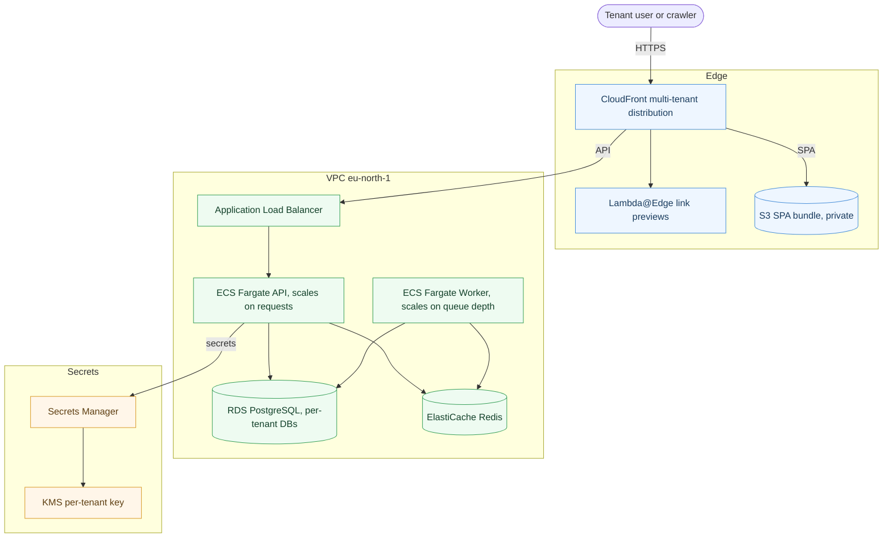

# Multi-Tenant SaaS Infrastructure

**Production AWS infrastructure for a multi-tenant, whitelabeled SaaS platform, built entirely with Terraform.**


> **Sanitized portfolio copy.** This is a real system I built and operate, shared with the client's permission. Account IDs, ARNs, hostnames and resource IDs are placeholders. The architecture, module layout, and reasoning are exactly as they run in production.

---

## Contents

- [Overview](#overview)
- [Architecture](#architecture)
- [Highlights](#highlights)
- [Repository structure](#repository-structure)
- [How it works](#how-it-works)
- [Design decisions](#design-decisions)
- [Getting started](#getting-started)
- [Tech stack](#tech-stack)

---

## Overview

One backend serves many tenants. Each tenant gets its own branded app on its own domain, and each tenant's data is kept isolated from the others. Adding a tenant is a configuration change, not a new deployment.

The hard parts of a model like this are **tenant resolution** (knowing which customer a request belongs to) and **data isolation** (making sure one tenant can never read another's data). This repository is how both are solved on AWS, with the API scaling on traffic and the background workers scaling on job backlog, all defined as reviewable code.

---

## Architecture



A request arrives on a tenant domain. CloudFront serves the single-page app from a private S3 bucket and forwards `/api/*` to the load balancer. The API reads the request origin to identify the tenant, fetches that tenant's database credentials from Secrets Manager (decrypted by a per-tenant KMS key), and connects to that tenant's database. Background jobs run on a separate worker service, so a job storm can never slow down someone loading a page.

---

## Highlights

### Multi-tenant edge
A single CloudFront distribution serves every tenant domain, each with its own TLS certificate, plus a Lambda@Edge function that generates social link-preview cards per tenant. Subdomain tenants are covered by a wildcard certificate, so onboarding one takes no certificate work at all.

### Three-gate secret isolation
A tenant's database credentials sit behind three independent gates. The registry database holds only the *address* of a secret, Secrets Manager holds the credential, and a dedicated KMS key decrypts it only for the application role, only from inside the VPC, and only when the tenant's ID is supplied as encryption context. No human and no other tenant can read it.

### Two tiers from one image
The API and the workers run the same container image, split by a single environment flag. The API scales on CPU and request count. The workers scale on job-queue depth, driven by a small Lambda that resizes the service every minute.

### Least-privilege networking
Public subnets hold only the load balancer and the NAT gateway. Everything else lives in private subnets behind a tight security-group chain, where each tier only accepts traffic from the tier directly in front of it.

### Operations built in
CloudWatch alarms flow through a formatter Lambda into one SNS topic that fans out to email and Slack. A crash-loop detector watches the worker service, and a notifier flags any time a human reads a production secret.

---

## Repository structure

```
environments/
  prod/        production composition
  staging/     simpler EC2-based environment
modules/       22 reusable modules (one concern each)
scripts/       backend bootstrap
```

| Module | Responsibility |
| --- | --- |
| `network` | VPC, subnets, internet/NAT gateways, route tables |
| `vpc-endpoints` | KMS, Secrets Manager, ECR, Logs, S3 endpoints |
| `security-groups` | ALB to ECS to RDS/Redis least-privilege chain |
| `secrets` | KMS keys, IAM task/exec roles, app + tenant secrets |
| `rds` | PostgreSQL with backups and point-in-time recovery |
| `cache` | ElastiCache Redis (non-cluster, failover) |
| `storage` | S3 buckets and bucket policies |
| `ecr` | Container image registry with lifecycle policy |
| `acm` | TLS certificates (regional + us-east-1) |
| `cloudfront-saas` | Multi-tenant distribution, OAC, origin policy, tenants |
| `lambda-edge-og` | Link-preview edge function |
| `ecs` | Cluster, API + worker services, ALB, autoscaling |
| `worker-autoscaler` | Queue-depth Lambda + schedule |
| `monitoring` | CloudWatch alarms + crash-loop detector |
| `ops-alerts` | SNS, Slack and alert formatter |
| `secret-access-audit` | CloudTrail + human-secret-access notifier |
| `github-ci-user` | Scoped IAM user for the deploy pipeline |
| `iam` `compute` `data` `amplify` `rds-proxy` | Earlier modules, kept for reference |

Every module has `main.tf`, `variables.tf`, and `outputs.tf`. An environment picks the modules it needs and wires them together in its `main.tf`.

---

## How it works

- **Remote state** lives in an S3 bucket with a DynamoDB lock table. Environments are isolated by their state key (`prod/terraform.tfstate`), not by separate buckets.
- **Two regions.** Everything runs in `eu-north-1` except the CloudFront certificates and the edge function, which must live in `us-east-1`. A second aliased provider handles that.
- **Secrets stay out of code.** Plan-time values are dummies; real values are supplied at apply, and `*.tfvars` is gitignored.

---

## Design decisions

- **Dedicated production VPC.** Prod runs in its own VPC on a non-overlapping CIDR instead of sharing one with a lower environment, so a problem in dev or staging can never reach prod at the network layer.
- **Bind KMS to the VPC endpoint, not an IP range.** Calls from a private subnet leave through NAT and present the NAT's public IP, so an IP-based rule would lock out the app itself. The key policy keys off the VPC endpoint instead.
- **Keep health checks shallow.** The load-balancer probe only checks that the process is up. Deep dependency checks live on a separate endpoint, because all tasks share one database and a dependency blip must not make the load balancer kill the whole fleet at once.
- **Single-AZ database, on purpose.** A deliberate cost trade-off for this stage, documented rather than hidden, with automated backups and point-in-time recovery enabled.

---

## Getting started

```bash
cd environments/prod
cp prod.tfvars.example prod.tfvars    # fill in real values locally (gitignored)

terraform init
terraform plan  -var-file=prod.tfvars -out=change.plan
terraform apply change.plan
```

The `Makefile` wraps the common commands, and `scripts/bootstrap-backend.sh` creates the state bucket and lock table on a fresh account.

---

## Tech stack

| Area | Services |
| --- | --- |
| IaC | Terraform (AWS provider ~> 6.x) |
| Compute | ECS Fargate (API + worker), Lambda, Lambda@Edge |
| Data | RDS PostgreSQL, ElastiCache Redis |
| Edge | CloudFront multi-tenant, S3 + OAC, ACM, Route 53 |
| Security | Secrets Manager, KMS, IAM, CloudTrail |
| Operations | CloudWatch, SNS, EventBridge, AWS Chatbot (Slack) |

The application it runs is a NestJS API with a React single-page app.
